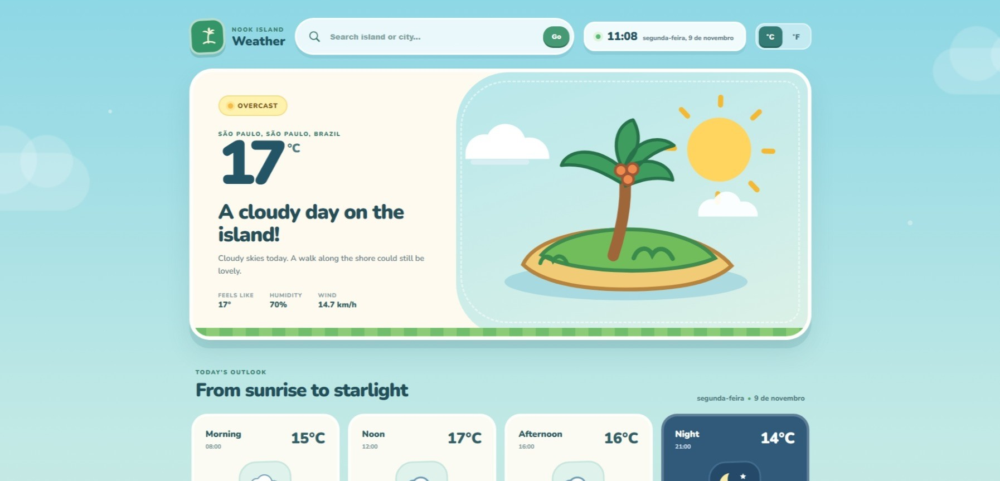

<div align="center">


### O clima da sua ilha, onde quer que você esteja 🌴

[](https://angular.dev/)
[](https://www.typescriptlang.org/)
[](https://open-meteo.com/)
[](https://www.netlify.com/)

[**Ver projeto no ar**](https://nookislandweather.netlify.app/)

</div>

## 🏝️ Sobre o projeto

O **IslandBreeze** é um aplicativo de previsão do tempo com clima de ilha tropical. A interface foi inspirada no universo acolhedor de *Animal Crossing: New Horizons*: cores suaves, paisagens ensolaradas e uma experiência leve para consultar o tempo de qualquer cidade.

Os dados meteorológicos e as informações de localização são obtidos pela API do [Open-Meteo](https://open-meteo.com/). A busca começa por São Paulo e você pode procurar outros lugares pelo nome.

## 🍃 Prévia

<p align="center">
  
</p>

> Para adicionar sua imagem, salve a captura de tela como `screenshot.png` dentro de uma pasta `docs` na raiz do projeto. Se preferir outro caminho ou nome, atualize o `src` acima.

## ☀️ Funcionalidades

- **Buscar cidades e ilhas:** encontre lugares pelo nome e selecione uma sugestão.
- **Ver o clima atual:** consulte temperatura, sensação térmica, umidade e velocidade do vento.
- **Acompanhar o dia:** veja a previsão em diferentes períodos, do nascer do sol à noite.
- **Planejar a semana:** confira a previsão para os próximos sete dias, com temperaturas máximas e mínimas, chuva e vento.
- **Alternar unidades:** escolha entre Celsius e Fahrenheit.
- **Tema diurno e noturno:** a paisagem acompanha a condição de dia ou noite informada para o local.

## 🌱 Tecnologias

- **Angular 22** para a aplicação web.
- **TypeScript** para a lógica e os componentes.
- **Angular Forms** para a busca de locais.
- **Open-Meteo Forecast e Geocoding APIs** para previsão do tempo e busca de localidades.
- **CSS** para a interface responsiva e as animações visuais.
- **Netlify** para publicação do projeto.

## 🐚 Como executar localmente

### Requisitos

- Node.js compatível com o Angular CLI do projeto.
- npm.

### Instalação

Clone o repositório e entre na pasta:

```bash
git clone https://github.com/malulimaa/island-breeze.git
cd island-breeze
```

Instale as dependências e inicie o servidor de desenvolvimento:

```bash
npm install
npm start
```

A aplicação ficará disponível em [http://localhost:4200](http://localhost:4200). O servidor recarrega a página quando os arquivos são alterados.

Para gerar a versão de produção:

```bash
npm run build
```

Os arquivos compilados são gerados na pasta `dist/`.

## 🗺️ Estrutura do projeto

```text
src/
├── app/
│   ├── services/
│   │   └── weather.ts       # Consultas às APIs do Open-Meteo
│   ├── app.html              # Estrutura da tela
│   ├── app.css               # Estilos da aplicação
│   └── app.ts                # Busca, clima atual e previsões
├── assets/images/            # Ícones e ilustrações do clima
├── main.ts
└── styles.css                # Estilos globais
```

## 🌺 Créditos

Projeto desenvolvido por [malulimaa](https://github.com/malulimaa). Dados meteorológicos fornecidos pelo [Open-Meteo](https://open-meteo.com/).

A interface é um projeto independente, inspirado no estilo aconchegante de *Animal Crossing: New Horizons*.

<div align="center">


*Feito com carinho e uma brisa tropical 🌴*

</div>
